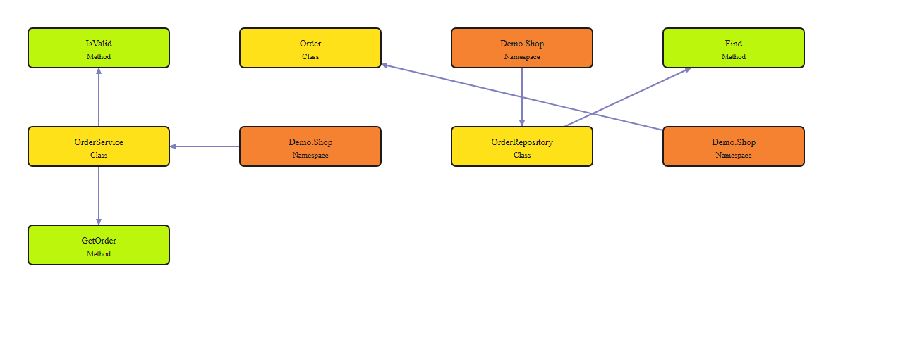

# Axiom Graph Engine

Turn a source repository into a local, queryable code graph. Build a snapshot,
keep it current as you edit, and share a diagram or structured JSON export.

**[Quickstart](docs/21-INSTALLATION-QUICKSTART.md)** ·
**[Try the demo](examples/first-graph/README.md)** ·
**[Documentation](docs/README.md)** ·
**[Command reference](docs/reference/axiom-graphd.md)**

## See what you get

Open the [offline demo walkthrough](examples/first-graph/index.html) after downloading
the example. The included store example starts with three small C# source files and produces
a graph of their declarations and containment relationships.



[Download and open the actual HTML diagram](examples/first-graph/output/html/result.html)
in your browser, or [run the example yourself](examples/first-graph/README.md).
GitHub displays HTML source; download the example or repository to view it.
The diagram works offline and needs no account or running service.

## Install

Use the [Axiom installer](https://github.com/orchex006/axiom-cli#install-and-update)
to install the prebuilt runtime for Windows x64, Linux x64 or macOS Intel.
Then open a new terminal:

```text
axm version
axm doctor
axge --help
```

You do not need Rust, Cargo or an Axiom source build. Apple silicon packages
are not currently available. See [installation](docs/21-INSTALLATION.md)
for platform requirements and troubleshooting.

## Your first graph

Register a solution and its local source folders with the two small documents
in the [quickstart](docs/21-INSTALLATION-QUICKSTART.md), then:

```text
axge build --solution my-app
axge query context --solution my-app --symbol MyNamespace.MyClass --json
axge export --solution my-app --out graph-export --format html --json
```

Open `graph-export/result.html` to explore the exported diagram. Replace the
solution and symbol with your registered names; the output folder must be new.
To refresh automatically while editing, run `axge watch` in a separate terminal.

## Choose a workflow

| You want to… | Start here |
|---|---|
| Try a complete example with known source and output | [First-graph demo](examples/first-graph/README.md) |
| Index your own repository | [Quickstart](docs/21-INSTALLATION-QUICKSTART.md) |
| Work across projects and repositories | [Solutions](docs/guides/solutions.md) |
| Build, query, watch or share a graph | [Workflow guide](docs/workflow-commands.md) |
| Use the graph from an AI coding agent | [Connect your agent](docs/guides/host-adapters.md) |
| Understand an error or stale result | [Troubleshooting](docs/guides/troubleshooting.md) |

## Understand the result

The current build/watch profile extracts declarations and containment from
supported C# and TypeScript source. It is useful for locating code and exploring
structure. Complete method-call graphs, runtime dependency injection, reflection
and dynamic behavior are outside that profile. Read [analysis coverage](docs/15-STATIC-ANALYSIS-COVERAGE.md)
before using a missing edge to judge change impact.

`axge` builds and exports graphs. `axm` manages installation and updates.
`axmp` exposes published graphs to connected agents through the local gateway.
[How the components fit together](docs/guides/packages.md) explains the distinction.

## Contribute

This repository contains the engine's production Rust source. The `crates/`
directory holds its modules; it is needed to build the product. See the
[developer guide](docs/development/README.md) for architecture, source builds,
tests and verification records. [Changelog](Changelog.md).
